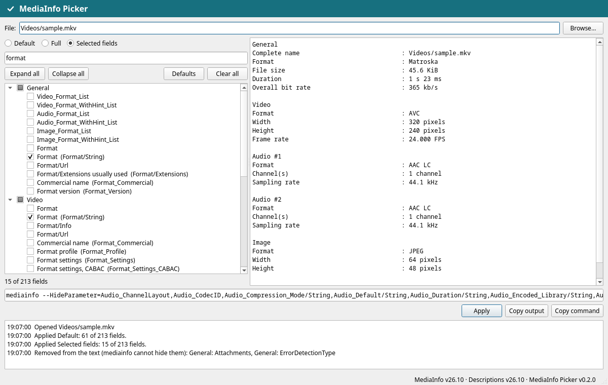

# MediaInfo Picker

[](https://pypi.org/project/mediainfo-picker/)
[](https://github.com/TheEverlastingBish/mediainfo-picker/actions/workflows/ci.yml)
[](https://github.com/TheEverlastingBish/mediainfo-picker/blob/main/LICENSE)
[](https://github.com/TheEverlastingBish/mediainfo-picker/blob/main/pyproject.toml)

**Choose exactly which [MediaInfo](https://mediaarea.net/en/MediaInfo) fields you see for a media
file, then copy the result, or the `mediainfo` command that prints it.**



`mediainfo` gives you two views of a file: its default summary, or `--Full`, which is hundreds of
lines. Anything in between means passing `--HideParameter` and `--ShowParameter` with internal field
names that the normal output never shows you. MediaInfo Picker lists every field your file has, by
its readable name and its internal one, lets you tick the ones you want, and does the rest.

Runs on Linux, macOS and Windows. Not affiliated with MediaArea.

## Features

- **Three views.** *Default* is what `mediainfo` shows on its own, *Full* is everything, and
  *Selected fields* is your own list.
- **Every field the file has**, grouped by section (General, Video, Audio #1, …), with MediaInfo's
  own description of each one as a tooltip.
- **Search** to filter the list as you type.
- **Start from the defaults or from nothing.** In Selected fields, **Defaults** ticks what
  `mediainfo` shows by default and **Clear all** unticks everything.
- **Copy output** puts the text on your clipboard; **Copy command** gives you the `mediainfo`
  command that prints the same text, ready for a script.
- **Your choice is remembered** between runs, and applies to every file you open.

## Install

You need two things first:

1. **MediaInfo's command-line tool**, `mediainfo`. MediaInfo Picker runs it; it is not included.

   | System | Command |
   |---|---|
   | Arch, CachyOS, Manjaro | `sudo pacman -S mediainfo` |
   | Debian, Ubuntu | `sudo apt install mediainfo` |
   | Fedora | `sudo dnf install mediainfo` |
   | macOS ([Homebrew](https://brew.sh/)) | `brew install media-info` |
   | Windows ([Chocolatey](https://chocolatey.org/)) | `choco install mediainfo-cli` |

   Or download the **CLI** version from [MediaArea](https://mediaarea.net/en/MediaInfo/Download).
   Check it works with `mediainfo --Version`.

2. **[uv](https://docs.astral.sh/uv/getting-started/installation/)** or
   **[pipx](https://pipx.pypa.io/stable/installation/)**, which install Python apps in their own
   space so they don't interfere with anything else.

Then install MediaInfo Picker with either one. It needs Python 3.12 or later.

### uv (recommended)

```bash
uv tool install mediainfo-picker
```

uv downloads a suitable Python by itself if you don't have one.

### pipx

```bash
pipx install mediainfo-picker
```

pipx uses the Python it runs on; if that's older than 3.12, point it at a newer one with
`pipx install --python python3.12 mediainfo-picker`.

### Update or remove

| | uv | pipx |
|---|---|---|
| Update to the latest release | `uv tool upgrade mediainfo-picker` | `pipx upgrade mediainfo-picker` |
| Remove | `uv tool uninstall mediainfo-picker` | `pipx uninstall mediainfo-picker` |

What changed in each release is in the
[changelog](https://github.com/TheEverlastingBish/mediainfo-picker/blob/main/CHANGELOG.md).

## Use

Start it from a terminal, optionally with a file:

```bash
mediainfo-picker
mediainfo-picker ~/Videos/film.mkv
```

1. **Browse…** to a media file. The first time, it opens in the *Default* view; after that, in
   whichever view you used last.
2. Choose **Selected fields**, then tick the fields you want. Use the search box to find one by
   name, or **Clear all** to start from nothing.
3. Press **Apply**, then **Copy output** or **Copy command**.

The log under the buttons says what happened and anything worth knowing about the last run. The
status bar shows the versions of MediaInfo, its field descriptions and MediaInfo Picker.

Your choices are saved in `settings.json`, in `~/.config/mediainfo-picker/` on Linux,
`~/Library/Preferences/mediainfo-picker/` on macOS and `%LOCALAPPDATA%\mediainfo-picker\` on
Windows.

## Good to know

- **Fields come from your own `mediainfo`**, read from the file itself, so they always match your
  version. Many fields have two forms, such as `Format` and `Format/String`; the default view
  mostly shows the `/String` one, which is the one to tick.
- **A few fields can't be hidden by `mediainfo` itself.** `Attachments` (in General) is one: it
  appears in the output, but `--HideParameter` doesn't accept it. MediaInfo Picker removes these
  from the text after the run instead, the log says which, and **Copy command** adds a small `awk`
  filter that removes them the same way.
- **The copied command is for a Unix-style shell**: bash or zsh, or on Windows Git Bash or WSL. It
  doesn't work in PowerShell or `cmd` yet.
- **Why Python 3.12:** on 3.11, PySide6 6.12 releases one reference to `None` too many on every
  `QTreeWidgetItem.setFlags()` call, and Python crashes once the count runs out. From 3.12, `None`
  is immortal and the bug is harmless.

## Contributing

Bug reports and ideas are welcome as
[issues](https://github.com/TheEverlastingBish/mediainfo-picker/issues). To work on the code:

```bash
git clone https://github.com/TheEverlastingBish/mediainfo-picker
cd mediainfo-picker
uv sync
uv run pre-commit install   # Ruff, strict mypy and the tests before each commit
uv run mediainfo-picker
uv run pytest
```

The tests use `tests/fixtures/`, a one-second synthetic `sample.mkv` and MediaInfo's recorded
output for it. Tests that run the real `mediainfo` are skipped when it isn't installed. The field
descriptions are MediaInfoLib's own tables, bundled in `src/mediainfo_picker/data/mediainfo-csv/`;
`uv run scripts/update-mediainfo-csv.py` refreshes them. Releases are made by pushing a tag, as
described in
[RELEASING.md](https://github.com/TheEverlastingBish/mediainfo-picker/blob/main/RELEASING.md).

## Licence

MIT, see [LICENSE](https://github.com/TheEverlastingBish/mediainfo-picker/blob/main/LICENSE). The
bundled MediaInfoLib field tables are © MediaArea.net SARL under the BSD 2-Clause licence; their
notice is in
[`LICENSE-MediaInfoLib`](https://github.com/TheEverlastingBish/mediainfo-picker/blob/main/src/mediainfo_picker/data/mediainfo-csv/LICENSE-MediaInfoLib).
